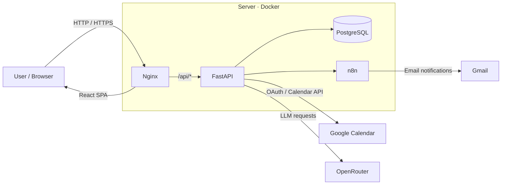
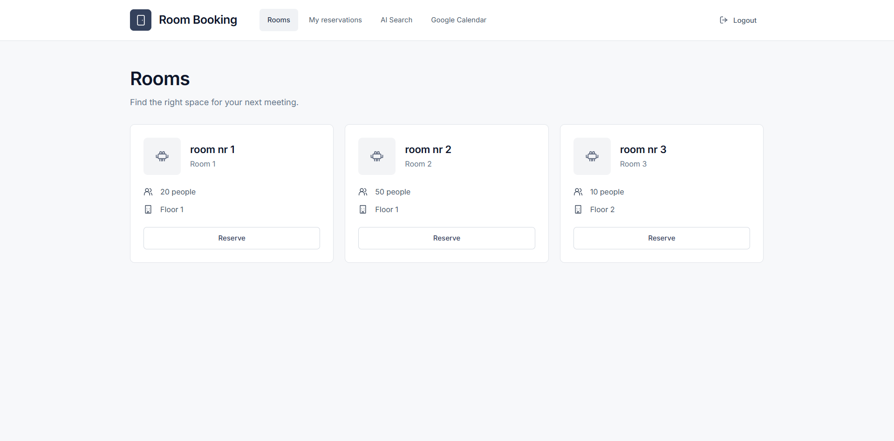
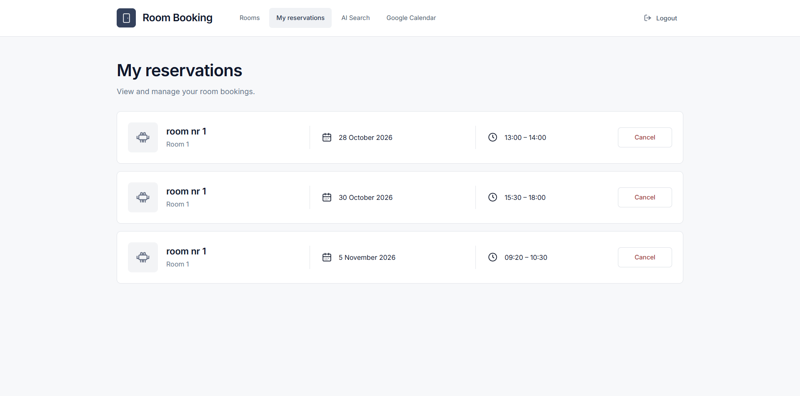
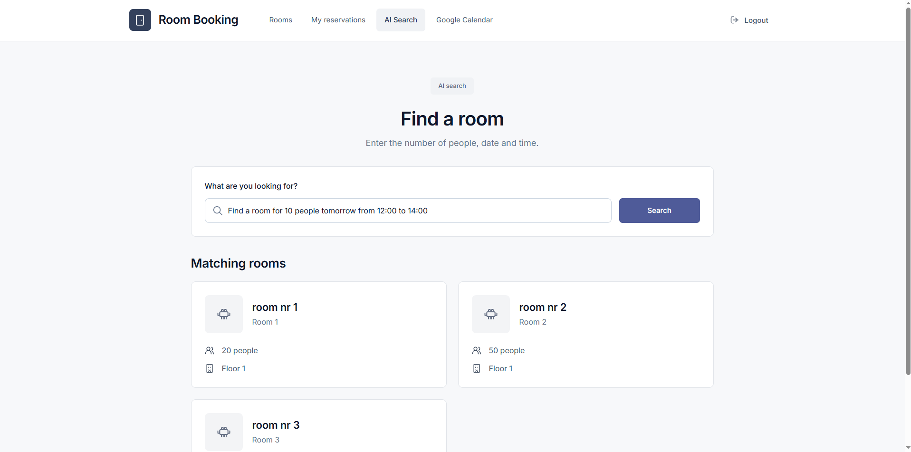
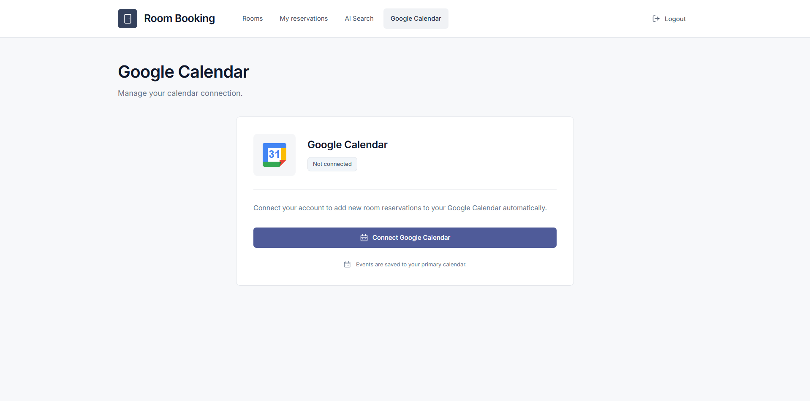

# Room Booking

A full-stack room reservation system designed for internal use in offices, coworking spaces, universities, or other organizations.

The application allows users to browse rooms, create and manage reservations, synchronize bookings with Google Calendar, search for rooms using natural language, and receive automated email notifications.

The project focuses on backend development, API integrations, AI-assisted features, containerization, and deployment.

## Features

- User registration and login
- JWT-based authentication
- Protected frontend routes
- Room browsing
- Creating and cancelling reservations
- Reservation conflict detection
- Personal reservation history
- Password reset with temporary single-use tokens
- Google Calendar integration via OAuth 2.0
- Automatic calendar event creation and deletion
- AI-assisted room search using natural language
- Automated emails using n8n
- React frontend
- PostgreSQL database
- Alembic database migrations
- Dockerized deployment
- Nginx reverse proxy

## AI Room Search

Users can search for rooms using natural language.

Example:

```text
Find a room for 10 people tomorrow from 12:00 to 14:00
```

The LLM converts the user's query into structured search parameters.

The backend is responsible for the actual availability checks and database queries, so the AI model is used only for interpreting the user's intent.

Supported scenarios include:

- searching for available rooms by date, time, and capacity
- checking the availability of a specific room
- displaying available time slots

## Architecture



## Tech Stack

### Backend

- Python
- FastAPI
- SQLAlchemy
- Pydantic
- PostgreSQL
- Alembic
- JWT
- httpx

### Frontend

- React
- Vite
- JavaScript
- React Router
- CSS

### Integrations

- Google Calendar API
- OAuth 2.0
- OpenRouter
- n8n
- Gmail

### Infrastructure

- Docker
- Docker Compose
- Nginx
- Ubuntu Server
- Git / GitHub

## Project Structure

```text
room_reservation/
├── frontend/
│   ├── src/
│   │   ├── components/
│   │   ├── pages/
│   │   ├── utils/
│   │   ├── App.jsx
│   │   └── config.js
│   ├── Dockerfile
│   ├── package.json
│   └── package-lock.json
│
├── nginx/
│   └── nginx.conf
│
├── alembic/
├── tests/
│
├── main.py
├── models.py
├── schemas.py
├── db.py
├── security.py
├── google_calendar.py
├── ai_service.py
├── webhooks.py
│
├── compose.yml
├── compose.dev.yml
├── compose.n8n.yml
├── Dockerfile
├── requirements.txt
└── README.md
```

## Local Development

### Requirements

- Docker
- Docker Compose
- Node.js
- npm

Clone the repository:

```bash
git clone <https://github.com/Kordianzawiszewski/room_reservation.git>
cd room_reservation
```

Create the backend environment file:

```text
.env
```

Example:

```env
POSTGRES_DB=room_booking
POSTGRES_USER=postgres
POSTGRES_PASSWORD=your_password

DATABASE_URL=postgresql+psycopg://postgres:your_password@db:5432/room_booking

JWT_SECRET_KEY=your_secret_key
OPENROUTER_API_KEY=your_openrouter_key
```

Additional Google OAuth credentials are required for the Google Calendar integration.

### Start backend and database

```bash
docker compose -f compose.yml -f compose.dev.yml up -d
```

To also start n8n:

```bash
docker compose -f compose.yml -f compose.dev.yml -f compose.n8n.yml up -d
```

FastAPI:

```text
http://localhost:8000
```

Swagger documentation:

```text
http://localhost:8000/docs
```

### Start frontend

```bash
cd frontend
npm ci
npm run dev
```

Frontend:

```text
http://localhost:5173
```

Development API configuration:

```env
VITE_API_URL=http://localhost:8000
```

## Production Build

Build the Docker images:

```bash
docker compose build
```

Start the application:

```bash
docker compose up -d
```

The application is served through Nginx:

```text
http://localhost
```

The production frontend uses:

```text
/api
```

for backend requests.

Nginx forwards those requests internally to FastAPI.

## Docker Setup

The production frontend uses a multi-stage Docker build.

```text
React source
    ↓
Node.js build stage
    ↓
npm run build
    ↓
dist/
    ↓
Nginx
```

The final frontend image contains only Nginx and the compiled frontend assets.

PostgreSQL data is persisted using a Docker volume.

## Google Calendar Integration

Users can connect their Google account through OAuth 2.0.

When connected:

- new reservations can create Google Calendar events
- cancelled reservations can remove corresponding events
- tokens are stored separately for each user
- refresh tokens are used to renew access when required

## Email Automation

n8n handles email workflows triggered by the backend.

Current events include:

```text
reservation.created
password.reset.requested
```

These workflows are used for:

- reservation confirmation emails
- password reset emails

## Password Reset

Password reset tokens are:

- randomly generated
- stored in the database as hashes
- valid only for a limited time
- single-use

The original token is sent to the user through the n8n email workflow.

## Security

Sensitive configuration is not stored in the repository.

Files such as the following should remain excluded from Git:

```text
.env
credentials_web.json
```

Environment variables prefixed with `VITE_` must never contain secrets because they can be included in the frontend bundle.

## Screenshots

### Rooms



### My Reservations



### AI Search



### Google Calendar



## Project Status

The core application is complete and deployed on a Linux server using Docker Compose and Nginx.

Possible future improvements:

- HTTPS and public domain
- automated database backups
- monitoring
- CI/CD
- extended administration features

## Author

Built as a portfolio project focused on Python backend development, API integrations, AI-assisted application features, Docker, and deployment.